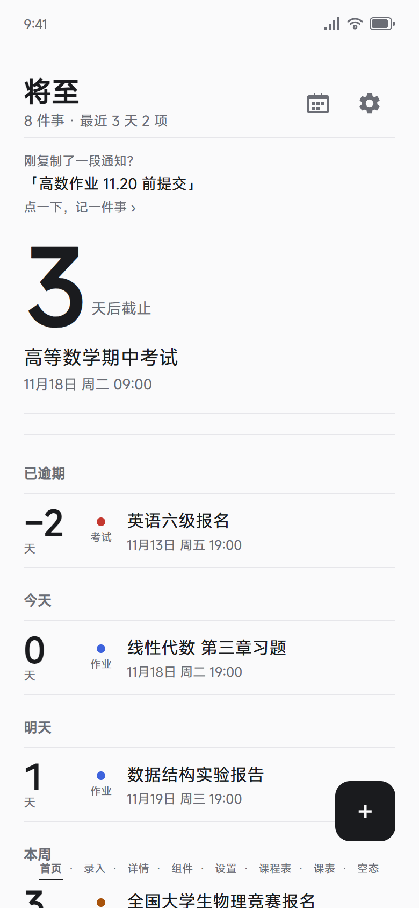
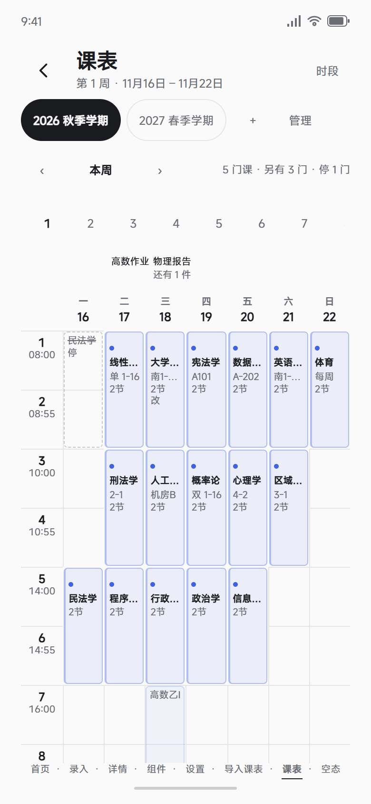
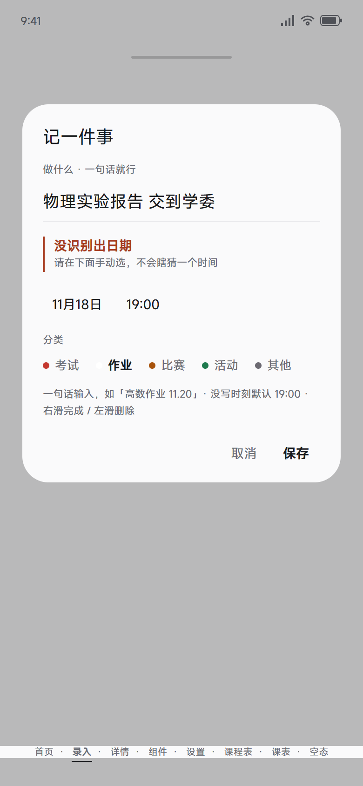
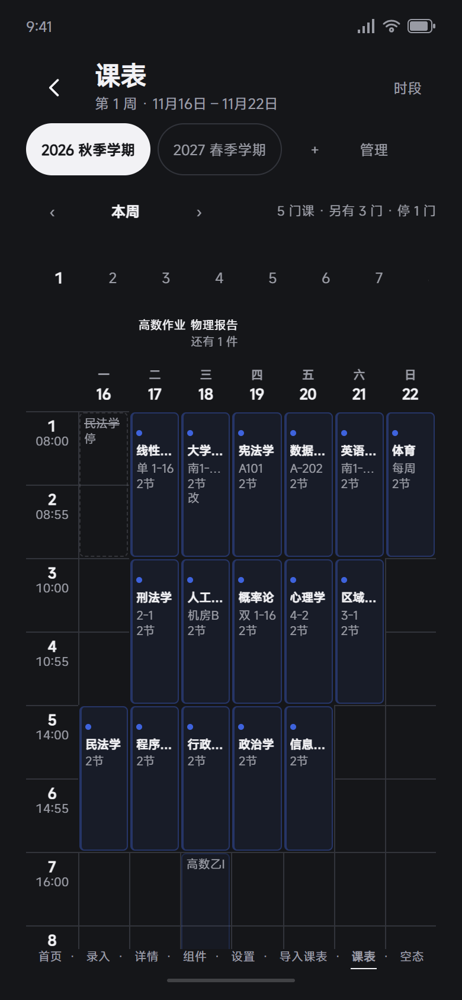
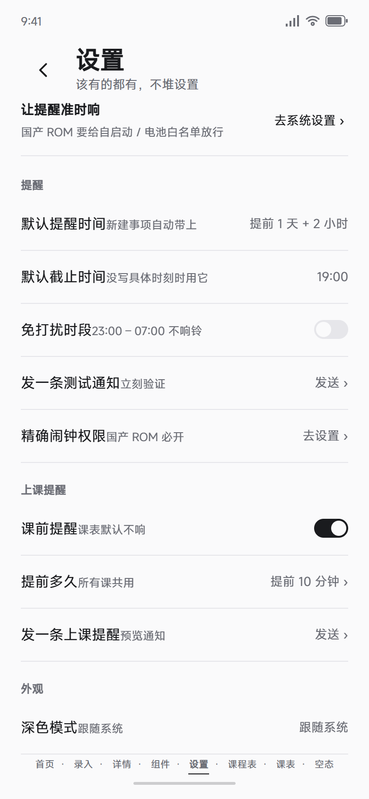
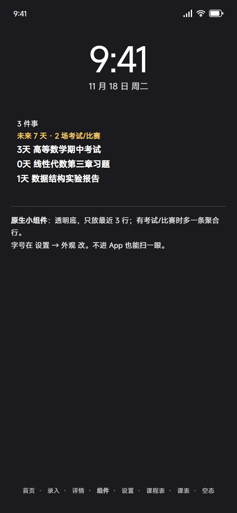

# 将至 · NearDue

> 只记一件事：**还有多久截止**。

一个极简的 Android 学生工具：**一句话记 DDL**（考试、作业、比赛、活动），再加一张**表格式课表**。首页一个大数字告诉你还剩几天，课表列头顺手显示当天要交的东西。

**没有账号、没有联网、没有广告。** 安装包里没有 `INTERNET` 权限——数据只存在你的手机里。

---

## 截图

| 首页 · 剩余天数 | 课表 | 一句话录入 |
|---|---|---|
|  |  |  |

| 课表 · 深色 | 设置 | 桌面小组件 |
|---|---|---|
|  |  |  |

> 以上为设计稿渲染图（`design/` 目录），与 App 实际界面一致。

---

## 功能

**录入**
- 一句话输入：「高数作业 11.20」「物理期末 12月14日 19:00」「四级报名 3.5 前」
- 中文日期解析：`11.20` / `11月20日` / `十一月二十日` / `明天` / `下周三` / `23:59` / `晚点名`
- 没写时刻 → 默认当天 19:00，预览里写清楚、可点改；**认不出日期就退回手动选，绝不静默猜**
- 剪贴板识别：回到 App 时读一次剪贴板，刚复制的群通知可一键记下
- 从系统分享菜单 / 选中文字「处理文本」直接带进来

**看**
- 按截止时间升序分组：已逾期 / 今天 / 明天 / 本周 / 更远 / 已完成（折叠）
- 大数字 = 剩余天数，排序即优先级，不用手动设
- 5 个分类色点：考 / 业 / 赛 / 活 / 其他
- 右滑完成，左滑删除（带撤销）

**提醒**
- 本地精确闹钟，默认提前 1 天 + 2 小时，可单条覆盖
- 免打扰时段（23:00–07:00 不响，醒来补发）
- 开机 / 改时区后自动重算

**课表**
- 表格式周课表，支持单双周、零散周次（`1,3,5-9`）、停课、调课、冲突提示
- 从教务系统导出的 **PDF 自动抽文字**（自带纯 Kotlin PDF 解析器，不引第三方库），或直接粘整张表
- 多学期并存，每学期独立作息
- 课表列头显示当天待办事项

**桌面小组件**：3 行倒计时 + 未来 7 天考试/比赛聚合条，字号可调

**数据**
- 本地 JSON 导出 / 导入（备份格式 v6）
- 无云同步、无网络请求

---

## 下载

到 [Releases](../../releases) 页下载最新的 `将至-vX.XX.apk`。

- 系统要求：**Android 8.0**（API 26）及以上
- 安装包约 **1.2 MB**
- 首次安装需在手机上允许「安装未知来源应用」

### APK 签名校验

本 App 用 EC P-384 证书签名。下载后可自行核对：

```bash
apksigner verify --print-certs 将至-vX.XX.apk
```

当前签名证书 SHA-256 指纹：

```
5370b2357a824d7d15365b568dde0e42b134bc6e3b54960fd48af2d35aa506b5
```

证书 `DN: CN=aiudhhwts, OU=NearDue, O=aiudhhwts, C=CN`（有效期至 2054-04-06）。

---

## 权限说明

只有三个，全部用于本地提醒：

| 权限 | 用途 |
|---|---|
| `POST_NOTIFICATIONS` | 发提醒通知（Android 13+ 运行时申请） |
| `SCHEDULE_EXACT_ALARM` | 到点准时响，不被系统延迟 |
| `RECEIVE_BOOT_COMPLETED` | 重启后重新登记闹钟 |

**没有 `INTERNET` 权限。** 代码里没有任何网络请求。

---

## 自己构建

环境：JDK 17、Android SDK 35（build-tools 35.0.0）。项目自带 Gradle Wrapper。

```bash
cd android
./gradlew :app:testDebugUnitTest     # 258 个 JVM 单测
./gradlew :app:assembleDebug         # 调试包
./gradlew :app:assembleRelease       # 未签名发布包（R8 + shrinkResources）
```

发布包需要自己的 keystore：

```bash
keytool -genkeypair -keystore release.keystore -storetype PKCS12 \
  -keyalg EC -groupname secp384r1 -sigalg SHA384withECDSA -validity 10000 \
  -alias neardue -dname "CN=<你的名字>, OU=NearDue, O=<你的名字>, C=CN"

export NEARDUE_KS_PASS='你的密码'
apksigner sign --ks release.keystore --ks-key-alias neardue \
  --ks-pass env:NEARDUE_KS_PASS --key-pass env:NEARDUE_KS_PASS \
  --v1-signing-enabled false --v2-signing-enabled true --v3-signing-enabled true \
  --out app-release.apk app/build/outputs/apk/release/app-release-unsigned.apk
```

> **自己签名的 APK 装不上本仓库发布的版本**（签名不同 = 不同 App）。想覆盖安装请用同一个 keystore，或先卸载旧版。


---

## 项目结构

```
android/                      Android 工程
  app/src/main/java/com/neardue/app/
    MainActivity.kt           单 Activity + Compose（列表 / 编辑对话框 / 设置）
    TimetableScreen.kt        周课表
    ChineseDateParser.kt      中文日期时刻解析（纯规则，零联网）
    PdfTextExtractor.kt       自写 PDF 文字提取（不引 pdfbox）
    ItemStore.kt / CourseStore.kt / TermStore.kt    SQLite 存储
    ReminderNotifier.kt / CourseReminderNotifier.kt  通知
    AlarmScheduler.kt / CourseAlarmScheduler.kt      精确闹钟
    NearDueWidget.kt          桌面小组件
  app/src/test/               258 个 JVM 单测
design/                       界面设计稿（HTML + CSS，8 屏，亮/暗双主题）
docs/screenshots/             README 用截图
```

`design/` 不是装饰：它和 App 用同一套文案与字号，改界面时先改设计稿、再同步到 Kotlin。

---

## 设计原则

1. **极简 = 录入路径极短**，不是功能少。任何新交互先问：会不会让用户在 5 秒内记不下一条 DDL？
2. **大数字优先**。用户要的不是日期，是「还剩多久」和「哪个最急」。
3. **不猜**。解析不出日期就退回手动选，绝不静默填一个时间。
4. **纸底墨字 + 一条细线**。彩色只有两类：5 个分类色点，以及录入框里「识别成功 / 没识别出」的状态色。
5. **安装包是预算，不是信仰**。不为省几十 KB 牺牲提醒可靠性。

---

## 许可证

[Apache License 2.0](LICENSE)
